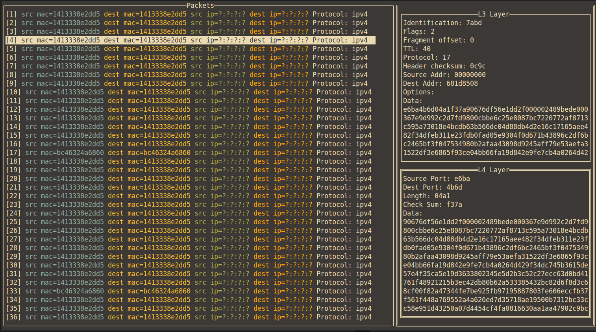

# snffff

Minimal packet sniffer using unix syscalls and byte parsing

## What it does 

- Intercepts ethernet packets using `AF_PACKET`  sockets
- parses layer 2-4 from osi
- grouping/reassembling tcp packets by flow



## Installation (works only on unix systems)

```bash 
git clone https://github.com/yacine204/snffff
cd snffff
go build -o main main.go
sudo ./main # raw sockets requires root priviliges 
```
